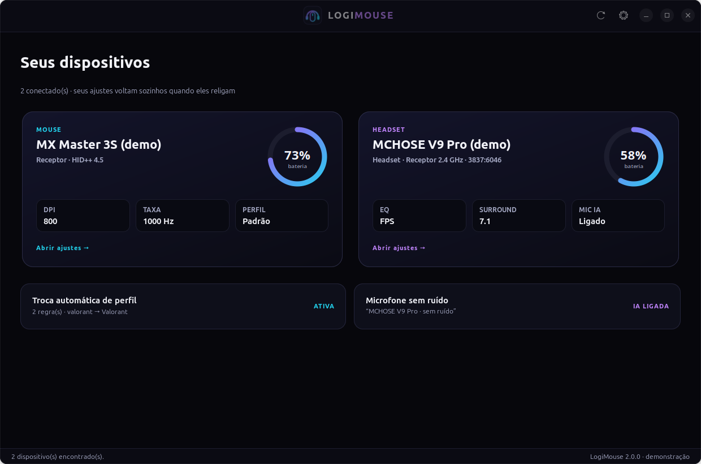
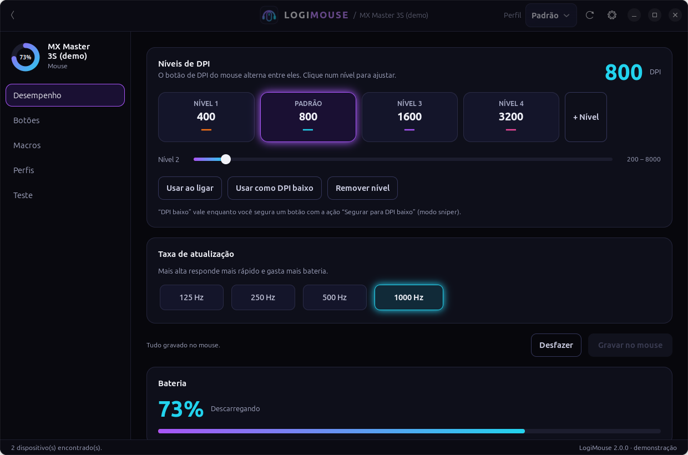
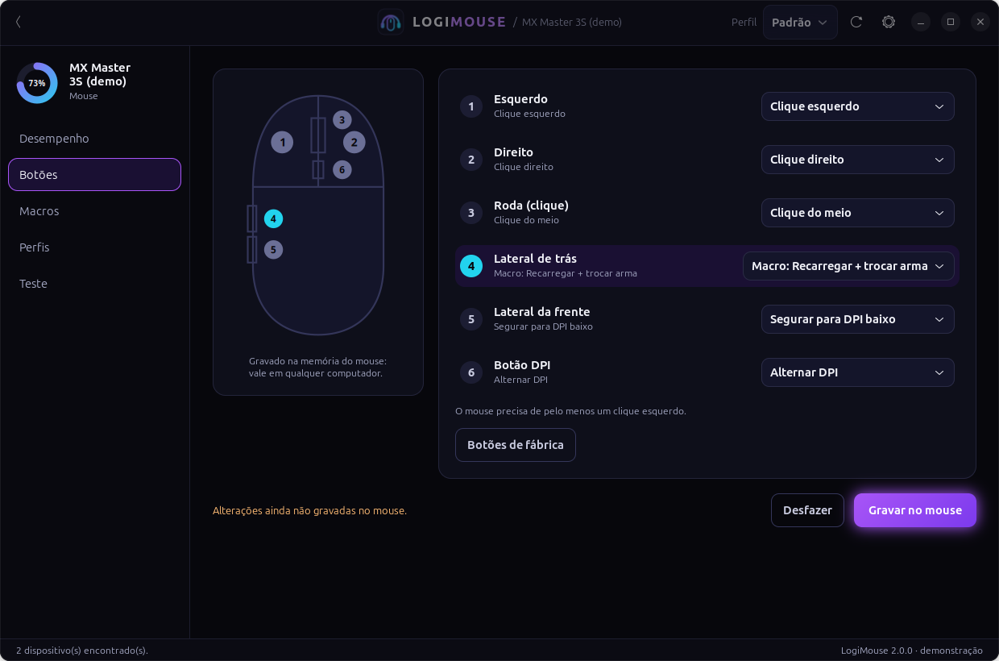
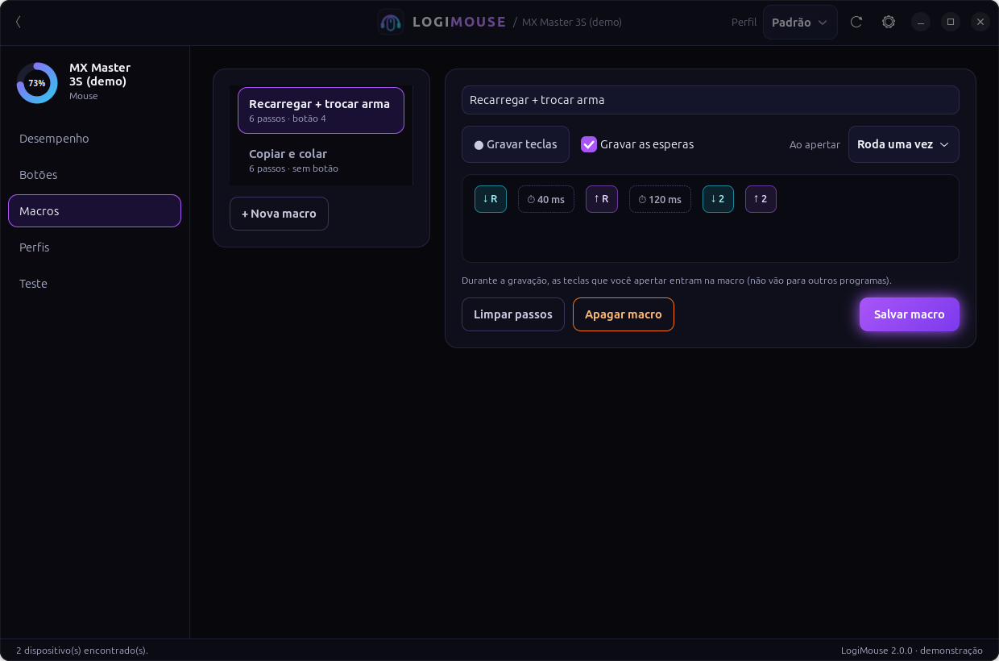
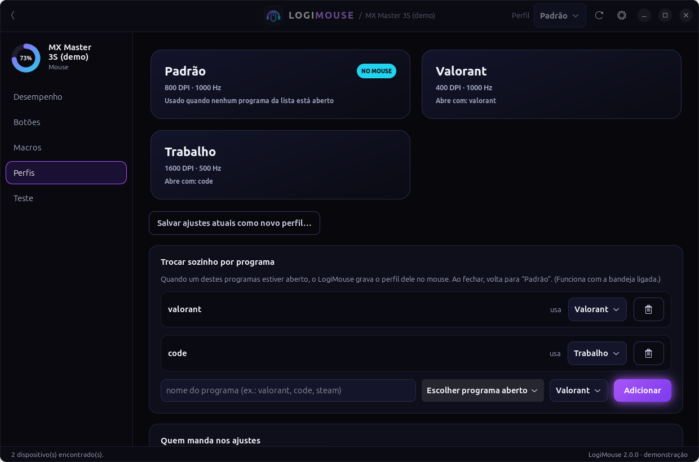
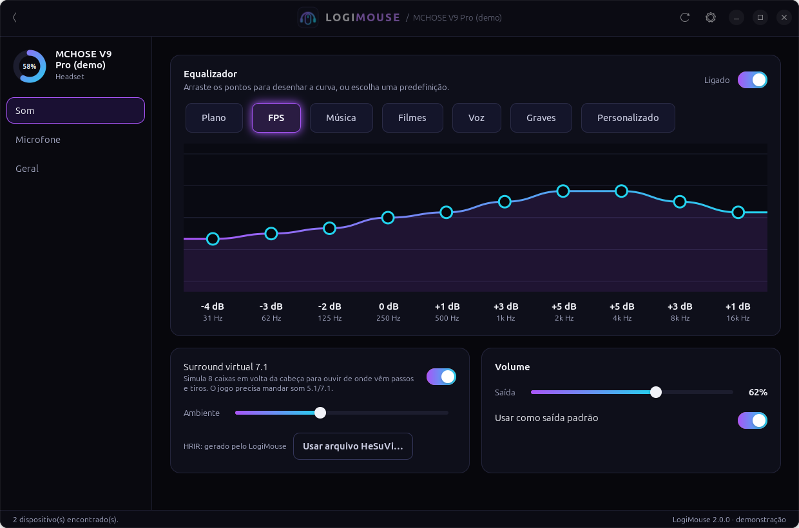
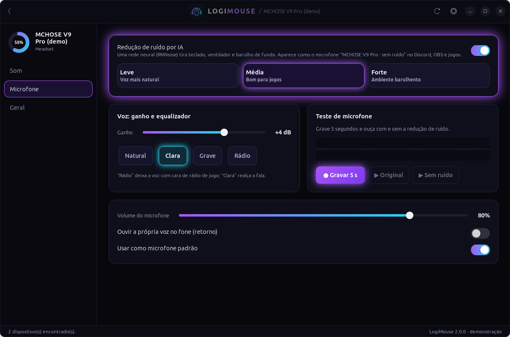

# LogiMouse

Painel para **mouses Logitech** e **headsets MCHOSE** no Linux. No mouse: níveis de DPI, taxa,
**remapear os botões**, **macros**, **perfis que trocam sozinhos por programa** e uma área de teste.
No headset (V9 Pro, V9, X9, que não têm o M HUB para Linux): bateria, **equalizador desenhável**,
**surround virtual 7.1** e **redução de ruído do microfone por IA** (RNNoise). Inclui um ícone na barra
com as baterias (`73%  🎧 58%`), que também **reaplica seus ajustes sozinho** quando o mouse religa.

Ele conversa direto com o mouse pelo protocolo **HID++ 2.0** (o mesmo do Logi Options+), sem
programas da Logitech e sem nada rodando como root.

<p align="center">
  
</p>

| Mouse: níveis de DPI e taxa | Mouse: ação de cada botão |
|---|---|
|  |  |
| **Mouse: macros** | **Mouse: perfis e troca por programa** |
|  |  |
| **Headset: equalizador e surround 7.1** | **Headset: microfone sem ruído por IA** |
|  |  |

<sub>Capturas feitas com o mouse e o headset simulados (`--demo`).</sub>

## O que há de novo na 2.0

- Painel novo em **GTK 4 + libadwaita**, tema escuro, com tela inicial de cartões (um por dispositivo).
- **Mouses G com memória de perfis** (G305, G502, G703...): até 5 níveis de DPI, "segurar para DPI
  baixo" (sniper), taxa e **ação de cada botão** (clique, voltar/avançar, DPI, tecla ou atalho, mídia,
  macro ou desativado), gravados na memória do mouse: valem em qualquer PC, mesmo sem o LogiMouse.
  Antes de gravar, uma cópia do perfil vai para `~/.config/logimouse/backups/`.
- **Macros** gravadas pelo teclado (teclas e esperas), rodando uma vez, enquanto segura ou liga/desliga.
- **Perfis** salvos no computador e **troca automática** quando um programa abre (ex.: Valorant).
- **Headset**: equalizador de 10 faixas (arraste os pontos), surround 7.1, microfone sem ruído por IA,
  ganho e EQ da voz, teste de microfone (grave e ouça com e sem a redução de ruído), retorno da voz.

## O que ele faz

Cada parte só aparece se o seu mouse tiver o recurso.

| Recurso | Detalhes |
|---|---|
| **Bateria** | % (ou nível aproximado nos mouses que só informam isso), carregando ou não |
| **DPI** | barra de ajuste e atalhos 400 / 800 / 1000 / 1600 / 3200 |
| **Velocidade do ponteiro** | nos mouses que têm esse ajuste |
| **Taxa de atualização** | 125 a 1000 Hz, até 8000 Hz em mouses gamer novos |
| **Roda** | catraca ou livre, SmartShift, alta resolução, inverter direção (linha MX) |
| **Modo host** | mouses G: faz o mouse obedecer o app em vez dos perfis salvos nele |
| **Ícone na barra** | % da bateria, aviso de bateria baixa, atalho para o painel |
| **Reaplicar ajustes** | ao ligar o PC, ao religar o mouse, ao recolocar o receptor ou reconectar o Bluetooth |
| **Iniciar com o sistema** | liga/desliga pelo painel ou pelo menu do ícone |
| **Atualização automática** | procura versão nova aqui no GitHub uma vez por dia e instala sozinho |
| **Headset MCHOSE** | bateria pelo receptor 2.4 GHz, no painel, na barra e com aviso de bateria baixa |
| **Outros headsets Bluetooth** | bateria lida do sistema (UPower), quando o fone informa |

Mouse: funciona com receptor **Unifying**, **Bolt** e **Lightspeed**, por **Bluetooth** ou pelo **cabo USB**.

### Headset MCHOSE

O receptor 2.4 GHz dos headsets MCHOSE (chip C-Media; fabricante USB `3837` no X9 e `291d:385d` no
V9 Pro) responde à pergunta
`55 65 01` com `55 65 <bateria> 02`. O protocolo foi descoberto para o **MCHOSE X9** pelo projeto
[HeadsetControl](https://github.com/Sapd/HeadsetControl) a partir do app oficial (M HUB), e foi
**confirmado num MCHOSE V9 Pro de verdade** (receptor `291d:385d` respondeu `55 65 32 02` = 50%). O LogiMouse só faz essa pergunta se o receptor tiver exatamente esse canal do
fabricante (report `0x55`), e ignora os outros avisos que o receptor manda sozinho.

- **Carregando** não aparece pelo receptor: com o cabo de carga plugado o fone sai do 2.4 GHz.
- No **Bluetooth**, a bateria vem do sistema, se o fone a informar.
- Volume, equalizador e luzes ainda não são controlados.
- Se o seu modelo não aparecer ou mostrar uma % estranha, rode `logimouse --diagnostico` com o fone
  ligado e [abra uma issue](https://github.com/felipecscontanova-glitch/logimouse/issues) com o arquivo
  `~/logimouse-diagnostico.txt`.

## Instalar

```bash
git clone https://github.com/felipecscontanova-glitch/logimouse.git
cd logimouse
./instalar.sh
```

O instalador:

1. instala o que faltar (GTK 4 + libadwaita, AppIndicator e notificações) pelo `apt`, `dnf`, `pacman` ou `zypper`;
2. cria as regras udev que deixam o seu usuário falar com o mouse e o headset e usar macros, sem `sudo`;
3. copia o app para `~/.local/share/logimouse` e cria o comando `logimouse`;
4. coloca o **LogiMouse** (com o ícone novo) no menu de aplicativos;
5. pergunta se pode baixar o plugin **RNNoise** (redução de ruído por IA, ~36 MB, do
   [noise-suppression-for-voice](https://github.com/werman/noise-suppression-for-voice));
6. pergunta se você quer **iniciar junto com o sistema** e já liga o ícone na barra (ele roda as macros
   e a troca de perfil por programa).

Ele pede sua senha (para os pacotes e a regra udev). Use `./instalar.sh -y` para aceitar tudo sem perguntas.
Depois disso o LogiMouse **se atualiza sozinho** (veja abaixo); seus ajustes são mantidos.

> Se o app disser "sem permissão", tire e recoloque o receptor (ou desligue e ligue o mouse) para a
> regra nova valer.

### Dependências

O app em si só usa a biblioteca padrão do Python 3.9 ou mais novo. Os pacotes do sistema são estes:

| Para | Ubuntu / Debian / Mint / Pop!\_OS | Fedora | Arch / Manjaro |
|---|---|---|---|
| Painel | `python3-gi python3-gi-cairo gir1.2-gtk-4.0 gir1.2-adw-1` | `python3-gobject python3-cairo gtk4 libadwaita` | `python-gobject python-cairo gtk4 libadwaita` |
| Painel antigo (se não houver GTK 4) | `python3-tk` | `python3-tkinter` | `tk` |
| Equalizador, surround, microfone | PipeWire (já vem no Ubuntu 22.10+, Fedora, Arch) | | |
| Ícone na barra | `python3-gi gir1.2-gtk-3.0 gir1.2-ayatanaappindicator3-0.1` | `python3-gobject gtk3 libayatana-appindicator-gtk3` | `python-gobject gtk3 libayatana-appindicator` |
| Aviso de bateria baixa | `libnotify-bin` | `libnotify` | `libnotify` |

**GNOME fora do Ubuntu** (Fedora, Arch, Debian puro): ative a extensão
[AppIndicator and KStatusNotifierItem Support](https://extensions.gnome.org/extension/615/appindicator-support/)
para o ícone aparecer. No Ubuntu ela já vem ligada. KDE, Cinnamon, XFCE e MATE mostram o ícone sem nada extra.

## Usar

- **Painel:** abra *LogiMouse* no menu ou rode `logimouse`. Cada mudança vale na hora e fica salva.
- **Ícone na barra:** mostra a bateria; clique para abrir o painel, reaplicar os ajustes ou ligar/desligar
  o início com o sistema.

### Por que reaplicar?

Muitos mouses Logitech **esquecem DPI, taxa e modo da roda** quando são desligados, ficam sem bateria ou
perdem o receptor. Com o ícone rodando, o LogiMouse percebe a reconexão (pelos avisos do receptor, do
próprio mouse ou pela volta do dispositivo Bluetooth) e reenvia o que você escolheu, em cerca de 2 segundos.

Só são reaplicados os ajustes que **você mudou** no painel. Para voltar ao comportamento de fábrica de um
mouse, use **Esquecer ajustes** no painel.

### Atualização automática

Com o ícone na barra rodando, o LogiMouse procura uma versão nova neste repositório **uma vez por dia**
(a primeira 2 minutos depois de ligar o PC). Se houver, ele:

1. baixa a versão do GitHub;
2. confere se ela está inteira, é a versão certa e abre sem erro, e só então troca o programa;
3. guarda a versão anterior e reabre o ícone já na nova, avisando com uma notificação.

Não pede senha, porque o programa fica na sua pasta pessoal. Se a versão nova mudar a permissão de
acesso ao mouse (regra udev), a notificação pede para rodar o `instalar.sh` de novo.

Para desligar, desmarque **Atualizar automaticamente** no painel ou no menu do ícone. Também dá para
procurar na hora pelo botão **Procurar atualização** ou por `logimouse --update`. Se uma versão nova
der problema, `logimouse --rollback` volta para a anterior.

> Rodando direto de um `git clone` (sem o instalador), o app só avisa da versão nova: use `git pull`.

### Terminal

```bash
logimouse                 # abre o painel
logimouse --tray          # só o ícone na barra
logimouse --cli           # mostra tudo no terminal
logimouse --dpi 1600      # muda o DPI (e salva)
logimouse --reapply       # reaplica os ajustes salvos agora
logimouse --autostart on  # liga o início com o sistema (off para desligar)
logimouse --check-update  # vê se há versão nova no GitHub
logimouse --update        # instala a versão nova agora
logimouse --rollback      # volta para a versão anterior
logimouse --diagnostico   # relatório do headset (para adaptar um modelo novo)
logimouse --demo          # testa com um mouse simulado, sem mexer nos seus ajustes
```

## Onde ficam as coisas

| Arquivo | Para quê |
|---|---|
| `~/.config/logimouse/config.json` | ajustes salvos de cada mouse e opções |
| `~/.config/autostart/logimouse.desktop` | início com o sistema |
| `~/.local/share/logimouse/` | o programa (e `logimouse.anterior/`, a versão antes da última atualização) |
| `~/.local/bin/logimouse` | o comando |
| `/etc/udev/rules.d/42-logimouse.rules` | permissão de acesso ao mouse e ao headset |
| `/etc/udev/rules.d/71-logimouse-macros.rules` | permissão para as macros (teclado virtual) |
| `~/.config/logimouse/backups/` | cópia do perfil do mouse antes de cada gravação |
| `~/.config/logimouse/audio.conf` | cadeia de filtros do PipeWire (equalizador, surround, microfone) |
| `~/.config/systemd/user/logimouse-audio.service` | serviço que mantém o som do headset ligado |
| `~/.local/lib/ladspa/librnnoise_ladspa.so` | plugin RNNoise (se você aceitou baixar) |

## Problemas comuns

| Sintoma | O que fazer |
|---|---|
| "Nenhum receptor ou mouse encontrado" | confira se o receptor está na USB ou o Bluetooth conectado; clique em **Atualizar** |
| "Receptor encontrado, mas nenhum dispositivo respondeu" | mexa o mouse para acordá-lo e clique em **Atualizar** |
| "Sem permissão" | rode o `instalar.sh` e recoloque o receptor |
| DPI não muda (mouse G) | em **Perfis**, escolha "Memória do mouse" e grave o DPI em **Desempenho** |
| Botão remapeado não funciona | em **Perfis**, confira se está em "Memória do mouse" |
| Macro não roda | ligue "Iniciar com o sistema" (o ícone na barra roda as macros) e rode o `instalar.sh` de novo |
| "Redução de ruído" desligada | rode o `instalar.sh` e aceite baixar o RNNoise |
| Equalizador sem efeito | escolha a saída "… · Equalizador" (ou ligue "Usar como saída padrão") |
| Painel abre no visual antigo | instale `python3-gi-cairo gir1.2-gtk-4.0 gir1.2-adw-1` (o `instalar.sh` faz isso) |
| Rolagem rápida demais | desligue **Rolagem em alta resolução** |
| Ícone não aparece no GNOME | ative a extensão AppIndicator (veja acima) |
| Solaar aberto ao mesmo tempo | funciona, mas um pode sobrescrever o ajuste do outro; prefira usar só um |
| Headset MCHOSE não aparece | rode o `instalar.sh` de novo (permissão do receptor) e recoloque o receptor |
| Headset aparece "desligado" | ligue o fone; com o cabo de carga plugado ele sai do 2.4 GHz |
| Headset com % estranha | `logimouse --diagnostico` e mande o resultado |

Para ver o que o ícone está fazendo, feche-o e rode `logimouse --tray` no terminal.

## Remover

```bash
./instalar.sh --remover
```

Isso apaga o programa, o atalho, o início automático e a regra udev. Seus ajustes ficam em
`~/.config/logimouse` (apague a pasta se quiser).

## Desenvolvimento

```text
src/logimouse/
  hidpp.py     protocolo HID++ 2.0, descoberta e reaplicação de ajustes
  headset.py   bateria de headsets MCHOSE (receptor 2.4 GHz) e UPower; --diagnostico
  window.py    painel novo (GTK 4 + libadwaita)
  gui.py       abre o painel novo ou, sem GTK 4, o antigo (gui_tk.py, Tkinter)
  onboard.py   memória de perfis dos mouses G (DPI, taxa, botões; HID++ 0x8100)
  macros.py    teclas, macros e teclado virtual (uinput)
  profiles.py  perfis no computador e troca automática por programa
  audio.py     equalizador, surround 7.1 e microfone sem ruído (PipeWire)
  assets/      logo e ícone
  tray.py      ícone na barra (AppIndicator), monitor de reconexão, macros e troca de perfil
  config.py    ajustes salvos, início com o sistema, trava de instância única
  update.py    atualização automática pelas tags do GitHub
  cli.py       modo terminal
  demo.py      mouse e headset simulados para testes e --demo
tests/         testes automáticos (rodam sem mouse)
data/          regra udev
instalar.sh    instalador
```

Rodar direto do código, sem instalar:

```bash
PYTHONPATH=src python3 -m logimouse --demo
```

Rodar os testes:

```bash
python3 -m unittest discover -s tests -v
```

Os testes usam um mouse simulado que responde como um de verdade, inclusive "esquecendo" os ajustes
ao ser desligado, para conferir que o monitor reaplica tudo na reconexão. O atualizador é testado com
pacotes falsos: certo, corrompido, com erro de código, com versão trocada e tentando gravar fora da pasta.

### Publicar uma versão nova

O atualizador compara a versão instalada com a versão escrita em `src/logimouse/__init__.py`
na branch `main` (e com as tags `vX.Y.Z`, se houver; vale a mais alta). Então, para lançar:

1. mude `__version__` em `src/logimouse/__init__.py` (por exemplo, para `1.3.0`) e anote no `CHANGELOG.md`;
2. faça o commit e envie para a `main` (`git push`).

Commits que não aumentam o número da versão **não** são enviados para ninguém, então dá para
trabalhar na `main` à vontade e só "lançar" quando mudar a versão. Se preferir, crie também uma
Release `v1.3.0` pelo site do GitHub para ter a página da versão.

No dia seguinte (ou na hora, pelo botão), quem tem o ícone rodando recebe a versão nova.

## Créditos

O protocolo do headset MCHOSE vem do driver do MCHOSE X9 no [HeadsetControl](https://github.com/Sapd/HeadsetControl),
que também é a melhor opção para outros headsets no Linux.

A interpretação do protocolo HID++ foi conferida com o código do [Solaar](https://github.com/pwr-Solaar/Solaar),
o gerenciador de dispositivos Logitech mais completo para Linux. Se você precisa remapear botões ou de
regras avançadas, use o Solaar (linha MX e escritório) ou o [Piper](https://github.com/libratbag/piper) (linha G).

LogiMouse não tem relação com a Logitech nem com a MCHOSE. "Logitech", "Unifying", "Bolt", "Lightspeed" e
"Logi Options+" são marcas da Logitech; "MCHOSE" é marca do seu fabricante.

## Licença

[MIT](LICENSE)
